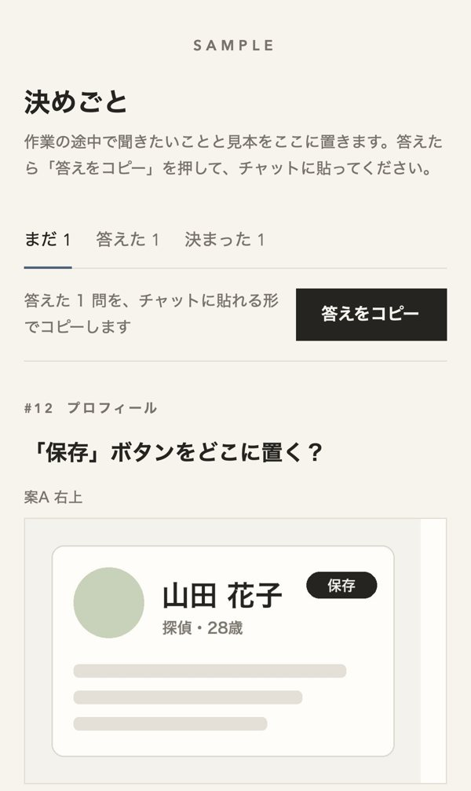
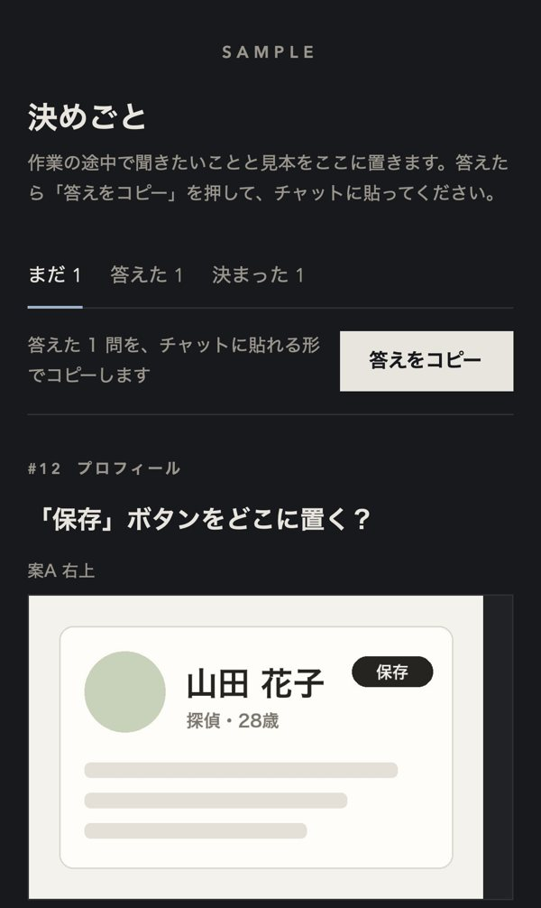

# decision-board（決めごとページ）

Claude Code 用のスキル。Claude が作業の途中で聞きたいことと見本の画像を、チャットに流さず1枚のページにまとめます。ページで選んで「答える」を押し、「答えをコピー」で出た文をチャットに貼れば、それが答えになります。

 

- 問いは見出し1行と選択肢。見本の画像は横に並べて見比べられる
- 「まだ」「答えた」「決まった」に分かれ、前に決めたことも見返せる
- 答えは貼った文として届くので、マージなどの操作もチャットの指示として進められる

ページは claude.ai のアーティファクト（初めは本人だけが見られる）で、答えはページのデータベース（`db`）にも残ります。

## 入れ方

```sh
git clone https://github.com/kaigemap/claude-skill-decision-board.git ~/.claude/skills/decision-board
```

Claude Code に「決めごとページで聞いて」と言うと使います。選択肢のある質問や、見本を見比べて選んでもらうときにも、Claude が自分で使います。

## 注意

- アーティファクトと、その実行時の機能（`db`）が使える環境が必要です
- 仕事で使うときは、ページに書く内容を claude.ai に置いてよいかを先に確かめてください

## English

A Claude Code skill that keeps Claude's questions and sample images on one artifact page instead of in the chat log. Pick an option, press 答える (answer), then 答えをコピー (copy answers) and paste the text into the chat; Claude treats the pasted text as your answer. Install with `git clone https://github.com/kaigemap/claude-skill-decision-board.git ~/.claude/skills/decision-board`. The page and the skill text are in Japanese.

## License

MIT
